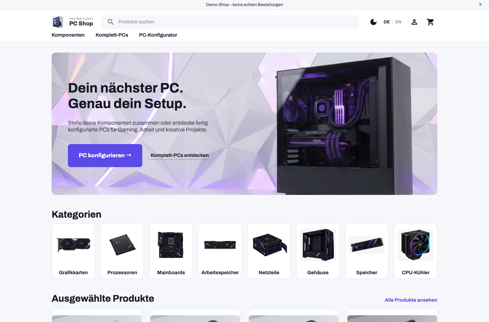
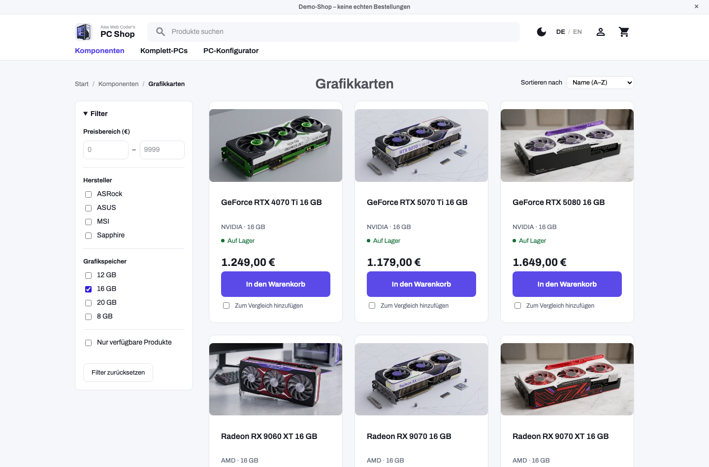
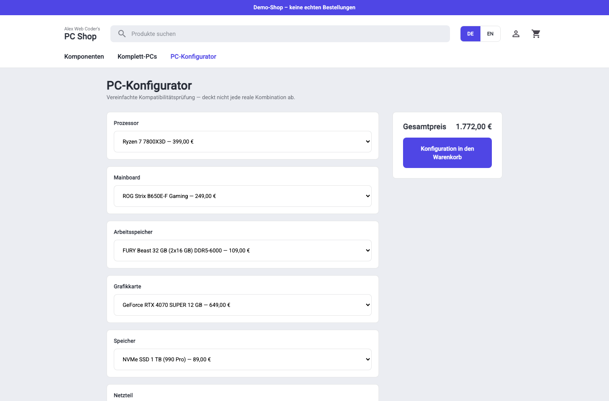
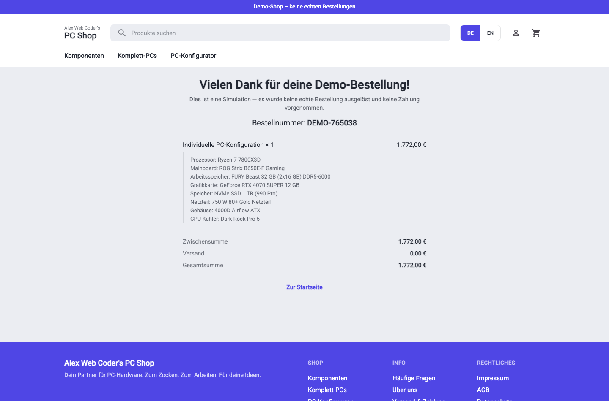

# Alex Web Coder's PC Shop

A portfolio project: a fictional PC-hardware shop — components, prebuilt PCs, and a
compatibility-checking PC configurator — built end to end in Angular 22. Fully bilingual
(German/English).

## Screenshots

| Home | Catalog filters |
| --- | --- |
|  |  |

| PC configurator | Order confirmation |
| --- | --- |
|  |  |

## What this demonstrates

- A full Angular 22 app built from scratch: standalone components, signals for state, typed
  Reactive Forms, lazy-loaded routes, a functional `HttpInterceptor` for the data layer.
- A product catalog with category browsing, filtering, sorting, and URL-persisted state.
- A cart and multi-step guest checkout, including order confirmation with a generated order number.
- A PC configurator that checks socket, RAM type, form factor, cooler clearance, GPU length, and
  PSU headroom against the sample dataset.
- A demo profile with editable fields, order history, and a one-click reset of all local demo data.
- Full DE/EN support via a small custom translation service, not `@angular/localize` (see
  *Architecture* below for why).
- A dark/light theme toggle, product comparison (up to 3, even across categories), and
  client-side search with autocomplete.

## Getting started

```bash
nvm use && npm install && npm start   # http://localhost:4200
```

## Architecture

Full rationale lives in [`docs/mvp.md`](docs/mvp.md#architecture-notes); the short version:

- **Structure**: flat `src/app/{pages,components,models,services,guards,interceptors}/`,
  organized by type rather than by feature — a deliberate choice for a project this size over the
  more common feature-folder convention.
- **State**: Angular signals in plain services (`CartService`, `TranslationService`, …) — no
  external state library. `CartViewService` and `PcConfigurationStore` show the pattern for
  joining/deriving state without duplicating it.
- **Data access**: services call `HttpClient` against paths like `/api/products`, answered by
  [`mock-api.interceptor.ts`](src/app/interceptors/mock-api.interceptor.ts) with simulated latency
  and a documented, deterministic failure trigger (checkout with the email `fehler@beispiel.de`
  simulates a failed order — never a random failure).
- **i18n**: a custom signal-based `TranslationService` + flat dictionary
  ([`translations.data.ts`](src/app/services/translations.data.ts)), not `@angular/localize`.
  Localize's per-locale-build model can't switch language at runtime without a reload, which would
  drop the in-memory cart and any in-progress form — this app switches instantly, mid-checkout,
  without losing either (verified in the acceptance pass).
- **Money**: always stored as integer cents, formatted per-locale only at render time.

## The PC configurator

Compatibility checks ([`pc-compatibility.ts`](src/app/services/pc-compatibility.ts)) are pure,
UI-independent functions: CPU/mainboard socket, RAM/mainboard DDR generation, mainboard/case form factor,
cooler socket + height clearance, GPU length vs. case, and a simplified PSU headroom check
(CPU + GPU TDP plus a fixed reserve). Missing components are reported separately from incompatible
ones, so the UI can tell "pick something" apart from "these two don't work together."

The sample catalog is curated on purpose — [`mock-api.data.ts`](src/app/interceptors/mock-api.data.ts)
documents two fully valid 8-part builds and one reachable invalid case per rule, all covered by
[unit tests](src/app/services/pc-compatibility.spec.ts).

A finished, valid configuration is stored as a synthetic `Product`-shaped entry
(`PcConfigurationStore`) rather than changing the cart's `{productId, quantity}` shape to know
about "product or configuration" — the entire existing cart/checkout/order-history pipeline handles
it as a normal line item, with its full component breakdown carried through to order confirmation.

## Additional features

- **Dark/light theme** — `ThemeService` (signal + localStorage, defaults to
  `prefers-color-scheme`) toggles a `data-theme` attribute; `_tokens.scss` overrides the neutral
  tokens and swaps the accent to a brighter indigo for the dark palette, since the light-mode
  accent read muddy against a near-black background.
- **Product comparison** — `CompareService` is deliberately session-only (not persisted, unlike
  cart/profile — a comparison tray is a transient aid). Compared products are stored as plain ids,
  capped at 3; the `/compare` page builds its spec table from the union of every compared
  product's spec keys, so comparing across categories works and just shows `—` for specs that
  don't apply.
- **Search + autocomplete** — `SearchService` filters the loaded catalog client-side; the header's
  search box has a live suggestions dropdown (closes on outside click), and Enter navigates to a
  full `/search` results page.

## Testing

57 unit/integration tests:

| Area | File | Tests |
| --- | --- | --- |
| Cart (add/remove/clamp/clear, subtotal calc) | `cart.service.spec.ts` | 12 |
| Shipping rule (flat rate, free threshold) | `order.service.spec.ts` | 3 |
| Configurator compatibility rules + pricing | `pc-compatibility.spec.ts` | 12 |
| Mock API interceptor (categories/products/404/orders/simulated failure) | `mock-api.interceptor.spec.ts` | 7 |
| Catalog filtering via real routing + URL query params | `product-list.component.spec.ts` | 5 |
| Checkout form validation, back-preserves-values, happy path, simulated error, double-submit guard | `checkout.component.spec.ts` | 5 |
| Product comparison (toggle, cap at 3, remove, clear) | `compare.service.spec.ts` | 6 |
| Client-side search (name/manufacturer match, suggestion cap) | `search.service.spec.ts` | 5 |
| App smoke test | `app.component.spec.ts` | 2 |

The catalog and checkout specs are deliberately integration-style rather than isolated unit tests —
`ProductList`'s behavior is inherently coupled to the router (query params *are* the filter state),
so it's tested through `RouterTestingHarness` with the real mock interceptor rather than mocked
dependencies; `Checkout` is driven through its rendered DOM (fill fields, click buttons, read the
confirmation) rather than reaching into component internals, so the tests exercise it the same way
a user would.

## How AI was used

Built iteratively with Claude Code against a written project plan (see `docs/`), one reviewed
commit per step rather than one large generation. Each step's compatibility rules, data model
choices, and architecture trade-offs (interceptor-based mocking, custom i18n, cart/configuration
integration) were deliberate design decisions made and understood while building — not just
accepted output.

## Demo script (~3 minutes)

1. **Home** → category grid → click into **Grafikkarten**.
2. Apply a manufacturer filter, note the URL updates — reload the page, filter state survives.
3. Open a product's **detail page**, add it to the cart.
4. **Cart**: change quantity, see the subtotal recompute, proceed to checkout.
5. **Checkout**: click "Beispieldaten einsetzen", step through shipping/payment, place the order —
   note the clear "this is a simulation" notice and demo order number.
6. **PC-Konfigurator**: pick incompatible parts first (e.g. an Intel CPU with an AM5 board) to show
   the conflict message, then build a valid combination and add it to the cart.
7. Switch language (DE ⇄ EN) mid-flow to show it doesn't lose cart or form state.
8. **Extras**: toggle dark mode in the header; check "Zum Vergleich hinzufügen" on 2–3 products
   (even from different categories) and open the floating compare bar; type a product name into
   the header search to show the live suggestions dropdown, then press Enter for the full results
   page.
